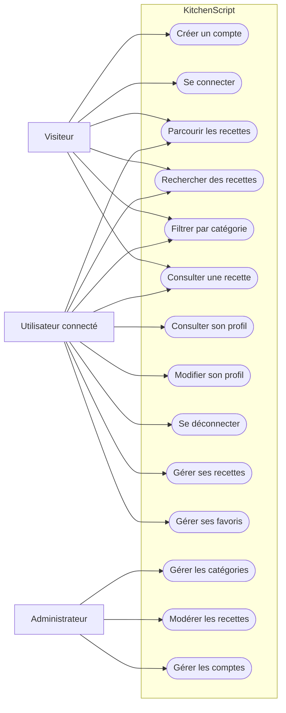
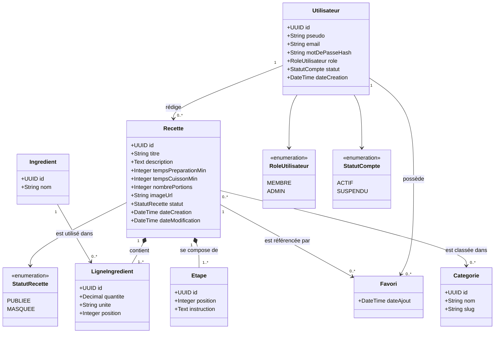
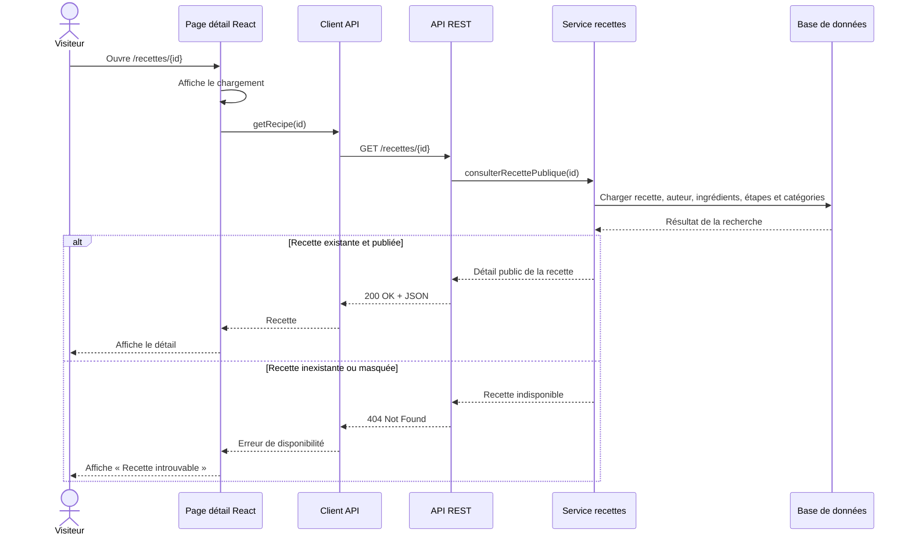
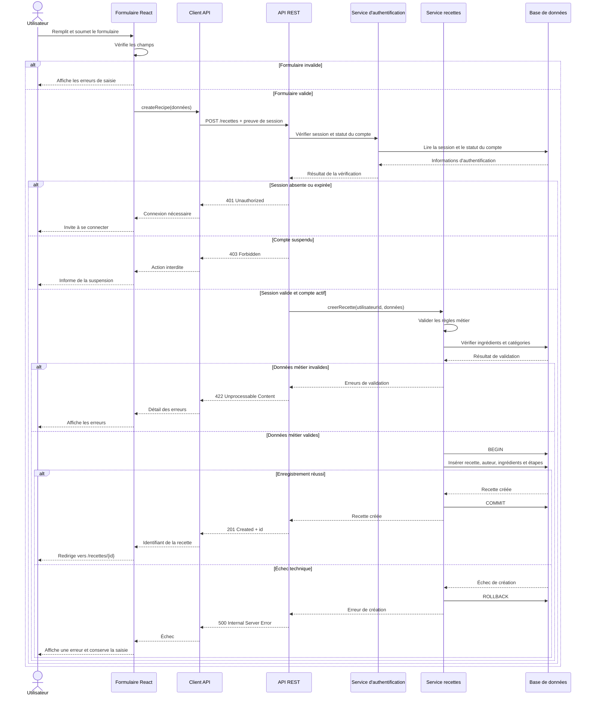

# KitchenScript

KitchenScript est une application de recettes de cuisine développée avec React.

## Conception UML

Les diagrammes suivants présentent les principaux cas d’utilisation, le modèle
du domaine et deux scénarios de séquence de l’application.

### Diagramme de cas d’utilisation

### Diagramme de classes du domaine

Contraintes métier principales :

- L’adresse e-mail et le pseudo d’un utilisateur sont uniques.
- Le mot de passe est stocké sous forme de hash.
- Une ligne d’ingrédient référence un ingrédient et appartient à une recette ;
  sa quantité doit être positive et sa position unique dans la recette.
- Les étapes d’une recette sont ordonnées à partir de 1.
- Le couple utilisateur-recette est unique dans les favoris.

### Diagramme de séquence — Consulter une recette

### Diagramme de séquence — Créer une recette

